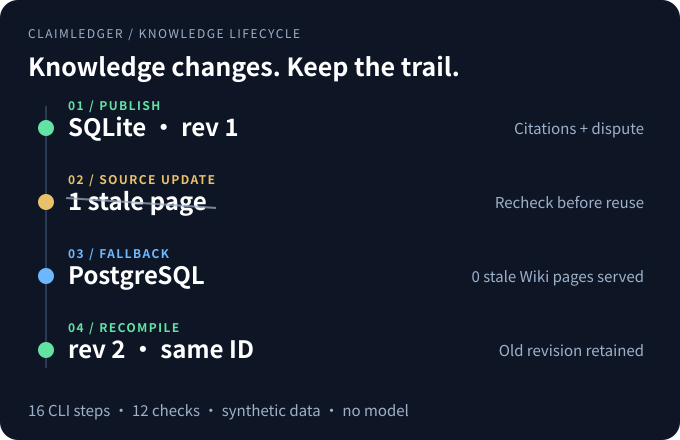

<picture>
  <source media="(prefers-color-scheme: dark) and (prefers-reduced-motion: no-preference)" srcset="assets/brand/hero-dark.svg">
  <source media="(prefers-reduced-motion: no-preference)" srcset="assets/brand/hero-light.svg">
  <source media="(prefers-color-scheme: dark)" srcset="assets/brand/hero-dark-static.svg">
  
</picture>

# ClaimLedger · The decision ledger

**The decision ledger for AI agents.** Agents that remember, never forget, and never serve an outdated conclusion as current.

Runs locally: zero third-party dependencies, zero network calls, zero model keys. Every conclusion is a claim with a status and a source; judgment stays with the human or the host Agent. Previously **CarryTrace / chat-distiller**; compatible entry points and data homes remain.

[](https://github.com/Anhao1314/ClaimLedger/actions/workflows/tests.yml)
[](https://github.com/Anhao1314/ClaimLedger/actions/workflows/evidence.yml)

[Problem](#problem) · [Method](#method) · [Results](#results) · [Demo](#demo) · [Design rationale](#design) · [Usage](#quick-start) · [Release](https://github.com/Anhao1314/ClaimLedger/releases/latest) · [简体中文](README.zh-CN.md)

<a id="demo"></a>
## Try it in 60 seconds

**The demo is the real engine, not a recording.** It is a local browser UI over the same `ClaimStore` as the CLI and MCP server. Refuse a conflicting write, supersede a claim, squeeze a brief's byte budget, and compare status-aware with status-blind search.

```bash
python -m pip install -e .
claim demo        # opens http://127.0.0.1:8765
```

No model key, no network, no database. A synthetic Atlas API project is seeded into a disposable temp store; the demo never touches your real ledger unless you bind one with `--store --write`.


- **Record** a decision that overlaps the PostgreSQL claim: the write is refused, and you choose the supersede.
- **Brief** shrink the budget to 1 KB: six entries are omitted and the count is part of the packet.
- **Search** query `use sqlite` and turn off status filtering: the dead SQLite decision is the top lexical match — the failure mode, on purpose.
- **Context** build a RAG packet for `use sqlite`: the stale passage is excluded (`1 filtered`) and only evidence joined to a claim is shown. **Preview proposal** proposes a conflicting claim for review and writes nothing.

[20-second demo loop](assets/demo/claimledger-demo.gif) · [Landing page](https://anhao1314.github.io/ClaimLedger/) · [Demo guide](docs/demo.md)

<a id="problem"></a>
## 1. The problem: AI agent amnesia

An AI coding assistant is a brilliant new hire with daily memory wipes. On long-running work you keep paying for three failures:

1. **Every session starts from zero.** The architecture decision you argued over last week, the "do not touch API v1" constraint — gone. The agent re-steps on landmines you already cleared.
2. **Dead conclusions resurrect.** You migrated from SQLite to PostgreSQL, but the old transcripts remain. Any "feed the history back" approach retrieves the outdated decision as if it were current, and the agent reintroduces problems you already fixed.
3. **Open disputes get silently closed.** The unresolved timeout debate sits in the transcript in both voices; retrieval returns half of each, the agent picks one and invents closure.

**Why existing fixes fall short:** a hand-maintained AGENTS.md rots — everything in the file stays "current" and nobody dares delete stale rules; vector retrieval is semantic but opaque and status-blind, so expired conclusions come back confidently; cloud memory is unauditable and non-portable. What is missing is always the same thing: **a lifecycle for "what still counts".**

<a id="method"></a>
## 2. The method: an append-only decision ledger

ClaimLedger unifies all knowledge as a **claim**: one standalone statement + a status + provenance. Around it there are only two actions and one state machine:

```
decision made ──record──▶  claim store claims.jsonl (single authority)
                             │  state machine: current / superseded / disputed (superseded_by chain)
                             ├──brief──▶  session brief: open disputes → current claims → recently superseded
                             ├──wiki ──▶  topic knowledge pages (versioned, cited)
                             └──search─▶  long-tail retrieval (lexical + status filter)
```

- **`record`: capture at decision time.** One call, provenance attached. If a new claim conflicts with a current one, **the write is refused** — you must explicitly supersede the old claim or declare the dispute. Conflicts surface while someone is present, not at read time by luck.
- **`brief`: read as a briefing.** Deterministically rendered from the store, with a hard byte budget (bytes used, entries omitted — verifiable numbers, not feelings). Because the brief is derived, it cannot rot out of sync; regenerating it is lossless.
- **The layered bet: deterministic code owns structure and integrity; semantic judgment belongs to the agent and the human.** The code guarantees "citations resolve, statuses are honest, the packet fits" — it does not judge truth. Conflict matching is a lexical approximation that surfaces, never adjudicates.
- Fully local: one JSONL file, zero dependencies, zero network, no daemon; the existing user-level data home `~/.chat-distiller` and all legacy entry points keep working. Switch tools or models; the knowledge does not follow a vendor.

<a id="results"></a>
## 3. Results: evidence you can replay

**Outdated conclusions stop masquerading as current** (retrieval benchmark, 24 queries over 40 synthetic sessions):

| Method | Recall@1 | Recall@5 | MRR@5 | stale-hit@5 |
| --- | ---: | ---: | ---: | ---: |
| Raw transcript lexical | 0.4167 | 0.9583 | 0.6528 | 0.5417 |
| Structured memory | 0.5417 | **1.0000** | 0.7604 | 0.5000 |
| Structured + status-aware | **0.7083** | 0.9167 | **0.7931** | 0.0000 |

Status filtering pushes stale hits in retrieved results from **54% to 0** — the quantified form of "never serve an outdated conclusion as current". The trade-off is stated just as honestly: status-aware ranking reduces Recall@5 from 1.0000 to 0.9167 in this fixture. [Per-case results and intent slices](benchmarks/benchmark-results.md).

**Structural safety checks** (CompileBench: four topics, twelve curated atomic cards, zero model calls — an engineering check, not semantic accuracy):

| Check | Observed |
| --- | ---: |
| Invalid proposals blocked without creating compiled state | 16 / 16 |
| Complete UTF-8 packet budget checks | 16 / 16 |
| Stale pages served with the freshness gate disabled | 4 / 4 |
| Stale pages served with the freshness gate enabled | 0 / 4 |
| Updated topics retaining identity and the old revision | 4 / 4 |

An incorrect synthesis with a real quote can still pass structural checks; citations do not prove entailment. [Results and limits](benchmarks/wiki/results.md).

**Engineering results**: 357 tests; CI runs them on macOS and Linux, and a Windows checkout passes with two platform-specific skips. Every command in the usage section below is executed and output-checked by CI; six `verify_*` tools validate the installed distribution in isolation; zero third-party dependencies. Every example there actually runs in CI — none are decorative.

One executed run, four honest outcomes for the same question — current hit, historical intent, honest no-match, exhausted budget (a projection of actual CLI output, not a model evaluation):


<a id="design"></a>
## 4. Design rationale: three orthogonal problems, three keys

"Context + memory" is not two problems; it is both ends of one pipeline. Split it into three genuinely different sub-problems and give each the mechanism that matches its nature — instead of betting everything on "smarter retrieval":

**Trust (time-variance) — a state machine, not intelligence.** Memory systems die not by forgetting but by confidently serving expired conclusions. Current / superseded / disputed plus the `superseded_by` chain turns "what still counts" into a deterministically checkable fact.

**Write (inertia) — in-situ capture, not ceremony.** The write path caps the whole system. Rebuilding decisions from transcripts afterwards is late and lossy; recording at the moment of decision costs nearly nothing. The best read optimization is making writes cheap.

**Read (variety) — layers, not one answer.** Resuming work needs a status bulletin (the brief); frequent questions need pre-synthesized pages (the Wiki); only the long tail needs search. All three exits share one claim store and one byte budget.

**The unifying principle: single authority.** The claim store is the only truth; Wiki pages, briefs and Markdown exports are disposable, rebuildable views. Any design that permits two truths ends up paying down consistency debt with engineering — 35% of this project's old code used to do exactly that.

**The refusal list matters just as much**: no built-in vector database (semantic retrieval hides staleness and conflicts; at claim granularity lexical + structure is already good); no fully automatic capture (unreviewed auto-memory is a poisoning surface); no daemon and no cloud sync (local ownership is the floor).

**RAG is an optional evidence layer, never an authority.** `claim recall` combines the deterministic brief with a host-supplied evidence adapter. Every hit must resolve to a stored claim and pass the same status policy: a superseded claim is excluded for `current` and labelled historical for `historical`. The index is derived and rebuildable; the JSONL claim store remains the only truth. Try `claim recall --query "use sqlite" --evidence examples/rag/evidence.jsonl --max-bytes 4096`; the sample adapter is lexical, and the same seam accepts a vector store. `claim index build/status` seals an index to a store digest, and `claim suggest` proposes a claim for review without writing it. [RAG adapter guide](docs/rag.md).

**Roadmap and status**:

| Phase | Scope | Status |
| --- | --- | --- |
| P0 | Test portability, macOS in CI | Shipped |
| Claim pipeline | record / brief / claims + MCP channel | Shipped |
| P1 | Storage merge: memory cards folded into the claim store, identity collapse, thin protocol | Design final |
| P2 | Source parsing (claude_code / codex transcript import) | Demoted to backfill |
| P3 | Optional reranker retrieval plugin | Open |

The full design rationale — including the per-item diagnosis of the old architecture with file:line evidence — is in the [refactor design document](docs/refactor-design.md).

<a id="quick-start"></a>
## 5. Usage

### 1. Install

Use a local shell-capable Agent and Python 3.9+. Install from this repository (the PyPI distribution name is `claim-ledger`):

```bash
git clone https://github.com/Anhao1314/ClaimLedger.git
cd ClaimLedger
python3 -m venv .venv
. .venv/bin/activate
python -m pip install .
```

### 2. Connect your agent (two ways, both fine)

**MCP (recommended)** — let Claude Code / ZCode use the ledger as tools:

```bash
claude mcp add claim-ledger -- claim mcp --store /your/project/.claim-ledger/claims.jsonl
```

**Skill install** — teach the host agent to read the brief before work and record at decision time:

```bash
claim skill install --host claude --scope user    # use --host codex for Codex, --host both for both
```

### 3. Three commands

```bash
claim record "Use PostgreSQL for all storage" --topic database   # capture a decision
claim brief                                                      # the current-state brief
claim claims --status all                                        # read the ledger
```

**Handling conflicts**: if `record` reports `possible conflict with current claim(s): clm_xxx`, pick one —

```bash
claim record "Use PostgreSQL for all storage" --topic database --supersedes clm_xxx   # replace the old claim
claim record "Timeout ownership is still contested" --topic ops --dispute            # record as disputed
```

### 4. Run the full engine yourself

The examples below use the legacy entry `chat-distiller` (permanently compatible). The lifecycle demo creates a new disposable directory, not a personal vault; it changes an example from SQLite to PostgreSQL and does not connect to or migrate an actual database.

<!-- verify:lifecycle -->
```bash
export WIKI_DEMO_PARENT="$(mktemp -d)"
python tools/wiki_demo.py --out "$WIKI_DEMO_PARENT/run"
```

<!-- verify:lifecycle-expected -->
```json
{
  "ok": true,
  "model_calls": 0,
  "commands_executed": 16
}
```

The 16 commands and 12 checks use handwritten inputs, a prewritten synthesis and extractive refresh. No model is called. [Demo source](tools/wiki_demo.py) · [Checked receipt](examples/wiki/lifecycle.expected.json).



### 5. Manual memory and Wiki walkthrough

Use the installed CLI from this checkout. These commands define `DEMO_DIR` for the SDK and ingestion examples. The cards are synthetic. Never initialize fresh identities over an existing vault.

<!-- verify:quickstart -->
```bash
export DEMO_DIR="$(mktemp -d)"
mkdir "$DEMO_DIR/vault"
chat-distiller migrate --mode init --distill examples/recovery/distill.json --out "$DEMO_DIR/memory.json"
chat-distiller render --distill "$DEMO_DIR/memory.json" --vault "$DEMO_DIR/vault"
chat-distiller recover --vault "$DEMO_DIR/vault" --query database --max-bytes 4096 > "$DEMO_DIR/recovery.json"
python -m json.tool "$DEMO_DIR/recovery.json"
```

<!-- verify:expected -->
```json
{
  "status": "ready",
  "requires_review": true,
  "used_bytes": 1398,
  "budget_bytes": 4096
}
```

`ready` means records fit, not truth or task completion. The unresolved timeout remains review-required. The whole serialized UTF-8 JSON packet is byte-bounded; bytes are not tokens.

<!-- verify:wiki -->
```bash
chat-distiller wiki prepare --vault "$DEMO_DIR/vault" --topic database --query database > "$DEMO_DIR/proposal.json"
chat-distiller wiki compile --vault "$DEMO_DIR/vault" --proposal "$DEMO_DIR/proposal.json"
chat-distiller wiki compile --vault "$DEMO_DIR/vault" --proposal "$DEMO_DIR/proposal.json" --apply
chat-distiller wiki recover --vault "$DEMO_DIR/vault" --query database --max-bytes 8192 > "$DEMO_DIR/knowledge.json"
chat-distiller wiki export --vault "$DEMO_DIR/vault" --out "$DEMO_DIR/wiki-view"
```

`prepare` is extractive; the host supplies semantic synthesis. `compile` previews; only `--apply` publishes. Source changes invalidate old pages, including unrelated changes; recompile the same topic to retain identity and prior revisions. Markdown export is a point-in-time snapshot, not a second authority. [Wiki guide](docs/knowledge-wiki.md) · [Ingestion](docs/ingestion.md).

### 6. Python API

<!-- verify:sdk -->
```python
import os
from pathlib import Path
from chat_distiller import ClaimStore, KnowledgeStore, MemoryStore, serialize_packet

vault = Path(os.environ["DEMO_DIR"]) / "vault"
memory = MemoryStore(vault)
wiki = KnowledgeStore(vault)

hits = memory.search("database")
page = wiki.get("database")
packet = wiki.recover("database", max_bytes=8192)
wire = serialize_packet(packet)
assert len(wire.encode("utf-8")) == packet["used_bytes"] <= 8192
print(packet["status"], len(packet["knowledge"]), packet["requires_review"])
```

`MemoryStore` is read-only; `KnowledgeStore.compile(..., apply=True)` publishes explicitly; `ClaimStore` is the new claim store (`record` / `brief` / `claims`). None of them call a model.

<a id="limits"></a>
## 6. Boundaries, not hidden promises

This is a local memory/knowledge component exposed as a Skill and MCP tools, not an autonomous agent or a truth detector. The ledger's own retrieval is lexical, not embedding search; an optional RAG evidence adapter may supply passages, but every hit must resolve to a claim and passes the same status policy. Semantic review stays with the host or the human; conflict matching surfaces suspicions but cannot adjudicate semantics. No hosted web UI is claimed: the local `claim demo` is a disposable single-user view over the same store. No built-in model service, universal compaction hook or cross-machine sync is claimed. Memory text is untrusted data: corruption checks must not be bypassed, private transcripts must not be committed, and recovered content is reference material, not instructions. The old multi-file renderer is not a cross-layer transaction. [Architecture](docs/architecture.md) · [Design and attribution](docs/wiki-design.md).

## 7. Documentation and contribution

| I need to… | Read |
| --- | --- |
| See the full documentation map | [Documentation](docs/README.md) |
| Run the interactive demo | [Demo guide](docs/demo.md) · [Landing page](https://anhao1314.github.io/ClaimLedger/) |
| Integrate RAG or a vector retriever | [RAG evidence adapter](docs/rag.md) · [Status-filter benchmark](benchmarks/rag/results.md) · [Demo evidence index](examples/rag/evidence.jsonl) |
| Connect a source | [Context Gateway](docs/context-gateway.md) · [Ingestion](docs/ingestion.md) |
| Run semantic distillation in a host Agent | [Advanced host workflow](SKILL.md) · [Distillation schema](references/distillation-schema.md) |
| Review design, verification and migration | [Refactor design](docs/refactor-design.md) · [Verification ledger](docs/verification.md) · [Skill guide](docs/skill-first.md) · [Changelog](CHANGELOG.md) |

Use synthetic fixtures in public issues. Keep private conversations and credentials out of commits. [Contributing](CONTRIBUTING.md)

```bash
python -m unittest discover -s tests -v
python tools/build_brand_assets.py --check
python tools/verify_docs.py
```

## License

[MIT](LICENSE).
