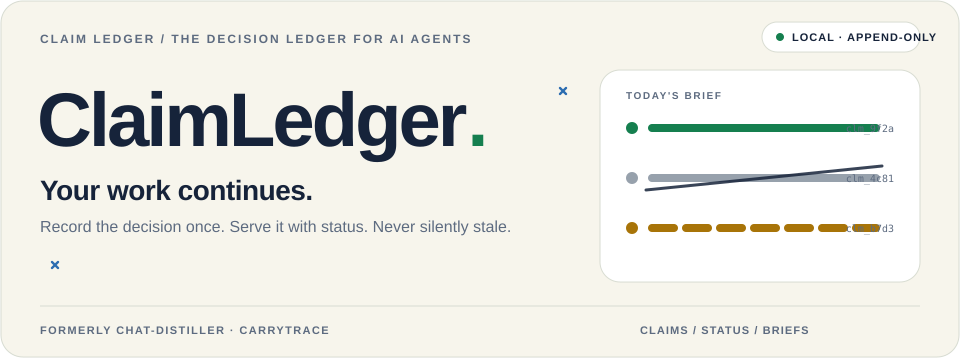
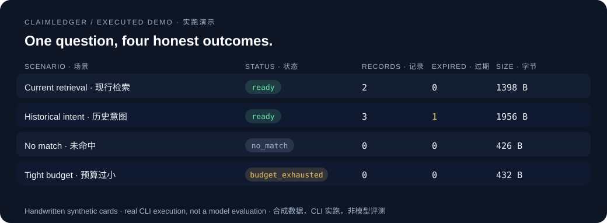
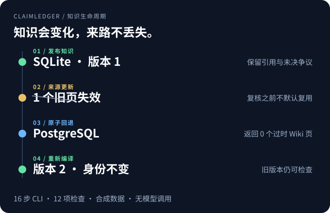

<picture>
  <source media="(prefers-color-scheme: dark) and (prefers-reduced-motion: no-preference)" srcset="assets/brand/hero-dark.svg">
  <source media="(prefers-reduced-motion: no-preference)" srcset="assets/brand/hero-light.svg">
  <source media="(prefers-color-scheme: dark)" srcset="assets/brand/hero-dark-static.svg">
  
</picture>

# ClaimLedger · 台账

**AI Agent 的决定台账。** 让 Agent 记得住、不失忆、不拿过期结论当现状。

本地运行：零第三方依赖、零网络调用、零模型密钥。每条结论都是带状态、带出处的"声明"，判断仍由人或宿主 Agent 完成。曾用名 **CarryTrace / chat-distiller**，兼容入口与数据目录均保留。

[](https://github.com/Anhao1314/ClaimLedger/actions/workflows/tests.yml)
[](https://github.com/Anhao1314/ClaimLedger/actions/workflows/evidence.yml)

[问题](#problem) · [方法](#method) · [效果](#results) · [演示](#demo) · [解题思路](#design) · [使用指南](#quick-start) · [发布版本](https://github.com/Anhao1314/ClaimLedger/releases/latest) · [English](README.md)

<a id="demo"></a>
## 60 秒上手演示

**演示跑的是真引擎，不是录屏。** 浏览器界面直接调用与 CLI、MCP 服务相同的 `ClaimStore`。你可以触发冲突拒写、显式取代、压缩简报的字节预算，并对比状态感知与状态盲检索。

```bash
python -m pip install -e .
claim demo        # 打开 http://127.0.0.1:8765
```

不需要模型密钥、不联网、不装数据库。演示会把一个合成的 Atlas API 项目写入一次性临时存储，绝不碰你的真实账本——除非你显式用 `--store --write` 绑定。


- **Record** 输入一条与 PostgreSQL 声明重叠的新决策：写入被拒绝，由你选择取代。
- **Brief** 把预算拉到 1 KB：省略六条，且省略数量写在包里。
- **Search** 搜索 `use sqlite` 并关闭状态过滤：已过期的 SQLite 决策成为最匹配结果——这正是要解决的失败模式。
- **Context** 为 `use sqlite` 构建 RAG 包：过期片段被排除（`1 filtered`），只展示能挂到 claim 的证据。**Preview proposal** 只生成待审提案，不写入。

[20 秒演示循环](assets/demo/claimledger-demo.gif) · [产品落地页](https://anhao1314.github.io/ClaimLedger/) · [演示指南](docs/demo.md)

<a id="problem"></a>
## 一、问题：AI Agent 的失忆症

AI 编程助手像个绝顶聪明但每天失忆的新员工。长期协作时，你会反复遇到三种事故：

1. **新会话从零开始。** 上周吵了半小时定下的架构决定、约定"不许动 API v1"的约束，新会话里全没了，Agent 重新踩你踩过的坑。
2. **过期结论复活。** 你们从 SQLite 迁到了 PostgreSQL，但旧会话记录还在。任何"把历史聊天喂回去"的方案都会把旧决定当现行事实捞出来，Agent 把你已经修掉的问题重新引入。
3. **争议被悄悄闭环。** 没吵完的问题（"超时到底是谁的锅"）两边发言都躺在记录里，检索出来一半一半，Agent 自己挑一个当结论，编造闭环。

**为什么现有方案不够：** 人工维护的 AGENTS.md 会腐烂——文件里写的永远"现行"，过期的规则没人敢删；向量检索语义强，但黑箱、无状态，过期结论照样自信返回；云端记忆不可审计、不可迁移。缺的是同一个东西：**一条"什么还算数"的生命周期。**

<a id="method"></a>
## 二、方法：一本只增不删的决定台账

ClaimLedger 把一切知识统一为**声明（claim）**：一段独立可懂的结论 + 状态 + 溯源。围绕它只有两个动作和一个状态机：

```
决策发生 ──record──▶  声明库 claims.jsonl（唯一权威）
                        │  状态机：现行 / 已替代 / 有争议（superseded_by 链）
                        ├──brief──▶  开工简报：未决争议 → 现行决定 → 最近被替代
                        ├──wiki ──▶  主题知识页（版本化，引用可查）
                        └──search─▶  长尾检索（词法 + 状态过滤）
```

- **`record`：写入即声明。** 决策发生的当场记一条，溯源自动附着。新声明与现行声明冲突时，**写入被拒绝**——必须显式选择"替代旧的"或"标成有争议"，矛盾在有人在场时摊开，而不是留到读时撞运气。
- **`brief`：读取即简报。** 从声明库确定性渲染，字节预算是硬契约（用了多少字节、漏了几条，都是可验证的数字）。因为简报是派生物，永远不会和事实脱节——重新生成即无损刷新。
- **分层赌注：确定性的代码管结构与完整性，语义判断留给 Agent 和人。** 代码保证"引用可查、状态如实、装得下"，不判断真假；冲突检测是词法近似，只能"摊开"不能"判定"。
- 全部本地：单文件 JSONL、零依赖、零网络、无常驻进程；既有用户级数据目录 `~/.chat-distiller` 与所有旧入口继续有效。换工具换模型，知识不跟着厂商走。

<a id="results"></a>
## 三、效果：可重放的证据

**过期结论不再冒充现状**（24 条查询的检索基准，40 个合成会话）：

| 方法 | Recall@1 | Recall@5 | MRR@5 | stale-hit@5 |
| --- | ---: | ---: | ---: | ---: |
| 原始转录词面检索 | 0.4167 | 0.9583 | 0.6528 | 0.5417 |
| 结构化记忆 | 0.5417 | **1.0000** | 0.7604 | 0.5000 |
| 结构化 + 状态感知 | **0.7083** | 0.9167 | **0.7931** | 0.0000 |

状态过滤把检索结果里的过期命中从 **54% 压到 0**——这正是"不拿过期结论当现状"的量化形态。代价同样如实：状态排序在这组数据中使 Recall@5 从 1.0000 降至 0.9167。[逐例结果与意图切片](benchmarks/benchmark-results.md)。

**结构安全检查**（CompileBench：四个主题、十二张人工编写的原子卡片、零模型调用。这是工程检查，不是语义准确率）：

| 检查项目 | 实际结果 |
| --- | ---: |
| 无效提案被拒绝，且未创建编译状态 | 16 / 16 |
| 完整 UTF-8 恢复包字节预算检查 | 16 / 16 |
| 关闭新鲜度检查后仍返回旧页 | 4 / 4 |
| 启用新鲜度检查后仍返回旧页 | 0 / 4 |
| 更新后保留知识身份与旧版的主题 | 4 / 4 |

带有真实摘录的错误综合仍可能通过结构校验，引用不证明结论被来源支持。[结果与局限](benchmarks/wiki/results.md)。

**工程效果**：399 个测试；CI 在 macOS 与 Linux 上运行，Windows 检出通过（2 个平台相关跳过）。下面"使用指南"中的每条命令都被 CI 实际执行并核对输出；六个 `verify_*` 工具在隔离安装环境验证发行完整性；零第三方依赖。那里的每个示例都是 CI 实跑的，不是装饰。

同一次实跑中，同一个问题的四种结局——命中现行、放行历史、诚实未命中、预算不足（实际 CLI 输出的投影，非模型评测）：



<a id="design"></a>
## 四、解题思路：三个正交问题，三把钥匙

"上下文 + 记忆"不是两个问题，是同一条管道的两端。把它拆成三个互不相同的子问题，每一层交给与它性质匹配的机制，而不是指望"更聪明的检索"包打天下：

**信（时变性）——用状态机解，不用智能解。** 记忆系统的死法不是遗忘，而是自信地端出过期结论。现行/已替代/有争议 + `superseded_by` 链，把"什么还算数"变成确定性可校验的事实。

**写（惯性）——用现场捕获解，不用仪式解。** 写路径的质量上限就是整个系统的上限。事后读转录重建决策注定滞后易漏；决策现场一条 `record` 成本趋近于零。最好的读优化是让写入变便宜。

**读（多样性）——用分层解，不用单一解。** 接续工作要的是"现状通告"（简报），高频问题要"综合好的页"（Wiki），长尾问题才需要检索。三种出口共享同一个声明库，全部受字节预算约束。

**贯穿的原则：单一权威。** 声明库是唯一真相；Wiki 页、简报、Markdown 导出都是可丢弃、可重建的视图。凡是允许两份真相的设计，最终都会用工程偿还一致性债务——本项目 35% 的旧代码曾经就在偿还这笔债。

**同样重要的是拒绝清单**：不内置向量库（语义检索会掩盖过时与冲突；声明粒度下词法+结构化已够好）；不做全自动写入（无人审查的自动记忆是投毒温床）；不做常驻进程与云同步（本地所有权是底线）。

**RAG 是可选的证据层，不是权威。** `claim recall` 把确定性简报与宿主提供的 evidence adapter 合成一个包。每条证据都必须解析到已存储的 claim，并接受同一套状态策略：`current` 下排除已过期证据，`historical` 下保留但标注历史。索引是派生、可重建的；JSONL 声明库仍是唯一真相。示例：`claim recall --query "use sqlite" --evidence examples/rag/evidence.jsonl --max-bytes 4096`；内置示例是词法适配器，同一个接口也可以接向量库。`claim index build/status` 把索引绑定到 store digest，`claim suggest` 只提案、不写入。[RAG 适配指南](docs/rag.md)。

**路线图与现状**：

| 阶段 | 内容 | 状态 |
| --- | --- | --- |
| P0 | 测试可移植性，CI 加入 macOS | 已落地 |
| 声明管道 | record / brief / claims + MCP 通道 | 已落地 |
| P1 | 存储合并：记忆卡片并入声明库，身份收敛，协议做薄 | 设计定稿 |
| P2 | 来源解析（claude_code / codex 转录导入） | 降级为回填路径 |
| P3 | 可选 reranker 检索插件 | 开放 |

完整设计依据（含对旧架构的逐条诊断与 file:line 证据）见[重构设计文档](docs/refactor-design.md)。

<a id="quick-start"></a>
## 五、使用指南

### 1. 安装

使用有本地 Shell 权限的 Agent 和 Python 3.9+。从本仓库安装（PyPI 发布名为 `claim-ledger`）：

```bash
git clone https://github.com/Anhao1314/ClaimLedger.git
cd ClaimLedger
python3 -m venv .venv
. .venv/bin/activate
python -m pip install .
```

### 2. 接入你的 Agent（两条路，可同时）

**MCP（推荐）**——让 Claude Code / ZCode 把台账当工具用：

```bash
claude mcp add claim-ledger -- claim mcp --store /你的项目/.claim-ledger/claims.jsonl
```

**Skill 安装**——让宿主 Agent 学会"开工先取简报、决策当场记录"：

```bash
claim skill install --host claude --scope user    # Codex 用 --host codex，两家都装用 --host both
```

### 3. 三条命令

```bash
claim init                                                  # 在当前目录创建 .claim-ledger/claims.jsonl
claim record "数据库统一使用 PostgreSQL" --topic database   # 决策当场记一条
claim record "冻结迁移窗口" --topic ops --scope production  # 限定生效范围
claim brief                                                  # 开工前的现状简报
claim claims --status all                                    # 翻台账
```

`claim init` 是幂等的：已有数据的账本会被拒绝，并把接入 Agent 的确切命令打印出来。Claim 还可带 `--scope`（决策适用的范围，互不相交的范围可共存）和 `--expires-at`（可选 UTC 截止时间；过期后不再算作现行，简报如实计入 time_expired，不改写历史）。

**冲突怎么处理**：如果 `record` 报 `possible conflict with current claim(s): clm_xxx`，二选一——

```bash
claim record "数据库统一使用 PostgreSQL" --topic database --supersedes clm_xxx   # 替代旧结论
claim record "超时问题责任仍有分歧" --topic ops --dispute                        # 记为有争议
```

### 4. 从任意聊天来源导入历史

Context Gateway 把既有会话历史变成干净转录和评审计划——支持豆包、通用 JSONL 和 Claude Code 会话：

```bash
claim connect generic --input talks.jsonl   # 或：claim connect claude-code
claim sync                                  # 只读暂存 + 评审计划
claim context "数据库迁移"                  # 蒸馏前即可词法检索
```

JSONL 契约：每行一个对象，含 `session_id`、`role`（`user`/`assistant`/`tool`/`system`）、`content`、`timestamp`（带时区的 ISO 8601）。[Gateway 指南](docs/context-gateway.md)。

### 5. 亲手跑一遍完整引擎

下面的示例使用旧入口 `chat-distiller`（永久兼容）。生命周期演示会创建新的临时目录，不使用个人知识库；示例从 SQLite 改为 PostgreSQL，但不会连接或迁移真实数据库。

<!-- verify:lifecycle -->
```bash
export WIKI_DEMO_PARENT="$(mktemp -d)"
python tools/wiki_demo.py --out "$WIKI_DEMO_PARENT/run"
```

<!-- verify:lifecycle-expected -->
```json
{
  "ok": true,
  "model_calls": 0,
  "commands_executed": 16
}
```

16 步命令、12 项检查使用人工编写的输入、预写综合与摘录式刷新，不调用模型。[演示源码](tools/wiki_demo.py) · [结果凭据](examples/wiki/lifecycle.expected.json)。



### 6. 记忆与 Wiki 手动教程

在仓库中使用已安装 CLI。下面定义的 `DEMO_DIR` 也供 SDK 与摄入示例使用。卡片是合成数据；绝不能用新身份初始化覆盖已有知识库。

<!-- verify:quickstart -->
```bash
export DEMO_DIR="$(mktemp -d)"
mkdir "$DEMO_DIR/vault"
chat-distiller migrate --mode init --distill examples/recovery/distill.json --out "$DEMO_DIR/memory.json"
chat-distiller render --distill "$DEMO_DIR/memory.json" --vault "$DEMO_DIR/vault"
chat-distiller recover --vault "$DEMO_DIR/vault" --query database --max-bytes 4096 > "$DEMO_DIR/recovery.json"
python -m json.tool "$DEMO_DIR/recovery.json"
```

<!-- verify:expected -->
```json
{
  "status": "ready",
  "requires_review": true,
  "used_bytes": 1398,
  "budget_bytes": 4096
}
```

`ready` 只表示记录装得下，不表示结论正确或任务完成。未解决的超时争议仍需要复核。预算计算完整 UTF-8 JSON 字节数，不是 token。

<!-- verify:wiki -->
```bash
chat-distiller wiki prepare --vault "$DEMO_DIR/vault" --topic database --query database > "$DEMO_DIR/proposal.json"
chat-distiller wiki compile --vault "$DEMO_DIR/vault" --proposal "$DEMO_DIR/proposal.json"
chat-distiller wiki compile --vault "$DEMO_DIR/vault" --proposal "$DEMO_DIR/proposal.json" --apply
chat-distiller wiki recover --vault "$DEMO_DIR/vault" --query database --max-bytes 8192 > "$DEMO_DIR/knowledge.json"
chat-distiller wiki export --vault "$DEMO_DIR/vault" --out "$DEMO_DIR/wiki-view"
```

`prepare` 生成摘录草稿，宿主负责语义综合；`compile` 默认预览，只有 `--apply` 才发布。包括无关修改在内的源变化都会使旧页失效；重编译同一主题会保留身份与旧版本。Markdown 导出是时点快照，不是第二份权威。[Wiki 指南](docs/knowledge-wiki.md) · [摄入](docs/ingestion.md)。

### 7. Python API

<!-- verify:sdk -->
```python
import os
from pathlib import Path
from chat_distiller import ClaimStore, KnowledgeStore, MemoryStore, serialize_packet

vault = Path(os.environ["DEMO_DIR"]) / "vault"
memory = MemoryStore(vault)
wiki = KnowledgeStore(vault)

hits = memory.search("database")
page = wiki.get("database")
packet = wiki.recover("database", max_bytes=8192)
wire = serialize_packet(packet)
assert len(wire.encode("utf-8")) == packet["used_bytes"] <= 8192
print(packet["status"], len(packet["knowledge"]), packet["requires_review"])
```

`MemoryStore` 只读；`KnowledgeStore.compile(..., apply=True)` 才显式发布；`ClaimStore` 是新声明库（`record` / `brief` / `claims`）。三者都不调用模型。

### 8. 多 Agent 并发、备份与删除

写入会获取跨进程写锁；超过超时时间会明确返回 `ClaimStoreBusy`，不会静默覆盖较新的版本。

```bash
claim backup --store /path/to/claims.jsonl
claim restore --from /path/to/backups/claims-....jsonl --store /path/to/claims.jsonl --yes
claim redact clm_... --store /path/to/claims.jsonl --yes
claim delete clm_... --store /path/to/claims.jsonl --cascade --yes
```

备份是可校验的规范快照与 manifest。脱敏会保留不含正文的墓碑和取代链；删除会移除记录，被引用时必须加 `--cascade`。两者默认写入审计记录和改动前的明文备份，可用 `--no-backup` 关闭；脱敏后的 Claim 不再进入简报和 RAG 证据。[数据安全](docs/data-safety.md)。

<a id="limits"></a>
## 六、能力边界，不藏在口号里

这是以 Skill 与 MCP 暴露的本地记忆与知识组件，不是自主 Agent 或真伪检测器。台账自身的检索是词法检索，不是向量搜索；可选的 RAG evidence adapter 可以提供原文片段，但每条证据都必须解析到 claim，并接受同一套状态策略。语义复核仍由宿主或人完成；冲突检测只能摊开疑似，不能判定语义矛盾。scope 是结构性标签而非强制的环境隔离；expires_at 是对可选时间戳的读取期策略，不是自动删除。不宣称提供托管 Web UI：本地 `claim demo` 只是同一存储上的一次性单用户视图。也不宣称内置模型服务、通用压缩钩子或跨机同步。记忆正文是不可信数据：不能绕过损坏检查，不可提交私人会话，恢复包里的内容是资料不是指令。旧多文件渲染器不是跨层事务。[架构](docs/architecture.md) · [设计与致谢](docs/wiki-design.md)。

## 七、文档与贡献

| 我想… | 阅读 |
| --- | --- |
| 看完整文档地图 | [Documentation](docs/README.md) |
| 运行交互式演示 | [演示指南](docs/demo.md) · [产品落地页](https://anhao1314.github.io/ClaimLedger/) |
| 融合 RAG 或向量检索 | [RAG 证据适配](docs/rag.md) · [状态过滤基准](benchmarks/rag/results.md) · [演示证据索引](examples/rag/evidence.jsonl) |
| 多 Agent 并发写入、备份、脱敏或删除 | [数据安全](docs/data-safety.md) |
| 接入一个数据来源 | [Context Gateway](docs/context-gateway.md) · [摄入与迁移](docs/ingestion.md) |
| 在宿主 Agent 中执行蒸馏 | [高级宿主工作流](SKILL.md) · [蒸馏规则](references/distillation-schema.md) |
| 复核设计、验证与迁移 | [重构设计](docs/refactor-design.md) · [验证台账](docs/verification.md) · [Skill 指南](docs/skill-first.md) · [Changelog](CHANGELOG.md) |

公开问题请提供合成复现材料，不要提交私人会话或凭据。[Contributing](CONTRIBUTING.md)

```bash
python -m unittest discover -s tests -v
python tools/build_brand_assets.py --check
python tools/verify_docs.py
```

## License

[MIT](LICENSE).
