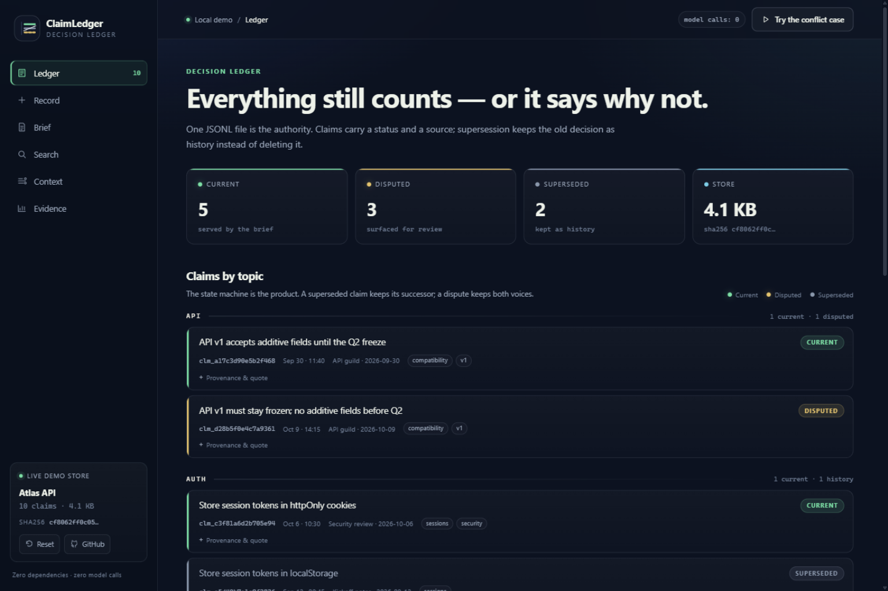

# ClaimLedger — demo and showcase kit

This is the presentation layer around the existing ClaimLedger engine: a local
interactive demo, a bilingual product page, screenshots, a short GIF, and this
script. The engine, data format and tests are unchanged except for two Windows
portability fixes found while packaging.

Every visual links to a real code path. There is no clickable mock and no model
call behind the demo.

## 10-second version

> ClaimLedger is a local-first decision ledger for AI agents. Decisions are
> claims with a status, a source and a supersession chain. A conflicting write
> is refused until a human or the host agent chooses. Zero dependencies, zero
> model calls.



## 30-second pitch

**English**

AI agents forget, or worse, they confidently repeat decisions you already
replaced. ClaimLedger gives every conclusion a lifecycle: **current**,
**superseded** or **disputed**. Recording a decision that conflicts with a
current one is refused — you explicitly supersede the old claim or keep the
dispute open. A byte-budgeted brief tells the agent what still counts and how
much it had to omit. Everything lives in one local JSONL file, exposed through a
CLI, an MCP server and an installable Agent Skill.

**中文**

AI Agent 会失忆，更糟的是会自信地重复你已经废弃的决策。ClaimLedger 给每条结论一个
生命周期：**现行 / 已过期 / 有争议**。与现行决策冲突的写入会被拒绝，你必须显式取代
旧声明，或者把争议保留下来。带字节预算的简报告诉 Agent 哪些决策还算数，以及为了装下
去省略了多少条。所有内容放在一个本地 JSONL 文件里，通过 CLI、MCP 服务和可安装的
Agent Skill 暴露。

## Demo script

Start the demo before the call:

```bash
claim demo
```

Then narrate while clicking. Timings assume the synthetic Atlas store.

| Time | Where | Do | Say |
| --- | --- | --- | --- |
| 0:00 | Ledger | Point at the four counters | “Ten claims. Five current, three disputed, two superseded. Status is part of the data.” |
| 0:12 | Ledger → database | Expand provenance on the SQLite row | “The old decision is still here, with a quote. It points to PostgreSQL as its successor.” |
| 0:24 | Record | Click **Conflicting decision**, then **Record claim** | “This says SQLite for production. The write is stopped before it touches the store.” |
| 0:38 | Conflict dialog | Read the conflicting claim, click **Supersede & record** | “A human picks the resolution. The old claim becomes history; the new one becomes current.” |
| 0:52 | Brief | Drag the budget to **1 KB** | “781 of 1,024 bytes. Six entries omitted — and the packet says six, instead of pretending it showed everything.” |
| 1:08 | Search | Search `use sqlite`, toggle **Include superseded** | “With the status filter off, the dead SQLite decision is the top lexical match. That is the failure mode.” |
| 1:22 | Search | Toggle it back off | “With the filter on, it cannot appear. The disputed claims still surface.” |
| 1:30 | Context | Build `use sqlite`, point at `1 filtered` | “RAG retrieved the stale passage and excluded it. Only evidence joined to a claim remains.” |
| 1:44 | Record | Type the SQLite decision, click **Preview proposal** | “This is a proposal, not a write. It shows the conflict and linked evidence.” |
| 1:56 | Evidence | Show the benchmark table | “54.2% stale hits go to zero, at a stated Recall@5 cost. Synthetic fixtures, zero model calls.” |

Close with the run command:

```bash
python -m pip install -e . && claim demo
```

## 5-minute technical walkthrough

1. **The problem** — read `README.md` §1. Three concrete failures: session-zero,
   resurrected conclusions, silently closed disputes.
2. **The data model** — one JSONL line per claim. Fields: `claim_id`, `text`,
   `status`, `topic`, `tags`, timestamps, `superseded_by`, `source`, `quote`,
   `session_hint`. The store is validated on every read; corruption refuses
   service.
3. **The write path** — `find_conflicts` is lexical and deterministic. It
   surfaces overlap; it never adjudicates semantics. `record` refuses an
   unresolved overlap, and requires `--supersedes` or `--dispute`. Mutations also
   take a cross-process writer lock. `backup`/`restore` use checksummed manifests,
   and `redact`/`delete` write audit entries plus a pre-change backup (disable
   with `--no-backup` for true erasure); see [data safety](docs/data-safety.md).
4. **The read paths** — `brief` renders a byte-bounded packet with explicit
   `omitted`; `claims` lists or searches; `recall` combines the brief with an
   optional status-filtered RAG/evidence layer (every hit must resolve to a
   claim; superseded evidence is excluded for `current`); `index build/status`
   seals the evidence index to a store digest; `suggest` proposes a claim
   without writing it; the Wiki and recovery views remain available under their
   original contracts.
5. **The proof** — `python -m unittest discover -s tests` (373 tests on this
   checkout), `python tools/verify_docs.py` (executes README commands),
   `benchmarks/` (retrieval and CompileBench reports). Quote the trade-off, not
   only the win.
6. **The demo layer** — `chat_distiller/demo/server.py` is stdlib HTTP only; it
   calls `ClaimStore` per request. The UI is static HTML/CSS/JS with no build
   step. `claim demo` seeds a temp store; a `--store` ledger is read-only unless
   `--write` is explicit.

## What is honest to claim

- The demo, screenshots and GIF come from the running local app.
- The scenario data is synthetic and handwritten; it is not a model evaluation.
- Retrieval is lexical; it is not embedding search and does not understand
  semantics.
- Conflict matching surfaces suspicion; a human or host agent resolves it.
- The 54.2% → 0 stale-hit result comes with a Recall@5 cost (95.8% → 91.7%).
- CompileBench checks structure and lifecycle safety, not factual truth.
- RAG is an optional evidence adapter, not a second authority: the index is
  derived and rebuildable, and every hit must resolve to a claim before it can
  enter the context packet.
- Zero third-party runtime dependencies; zero model calls in the engine, demo
  and asset build.

Avoid saying: “solves memory for all agents”, “automatically detects
contradictions”, “semantic search”, “production-ready hosted service”, or
“proves the synthesis is correct”. The project's refusal list is a feature.

## Portfolio copy

**One-line (EN):** Local-first decision ledger for AI agents — status-aware,
conflict-refusing memory with a one-command interactive demo.

**One-line (ZH):** 给 AI Agent 的本地决策账本：拒绝静默冲突、保留状态与出处的记忆层，
附带一条命令启动的交互式演示。

**Resume bullets (EN):**

- Built a zero-dependency local decision ledger (Python + JSONL) with a
  status state machine (`current` / `superseded` / `disputed`), byte-budgeted
  briefs and lexical retrieval; 373 tests.
- Designed and shipped an interactive demo and bilingual product site over the
  real engine (stdlib HTTP, vanilla JS), plus a reproducible screenshot/GIF
  asset pipeline.
- Quantified the core claim with a replayable benchmark: stale-hit@5 54.2% → 0,
  with the Recall@5 trade-off disclosed.

**Resume bullets (ZH):**

- 从零实现零依赖的本地决策台账（Python + JSONL），包含现行/已过期/有争议状态机、
  字节预算简报与词法检索，373 项测试。
- 基于真实引擎设计与交付交互式演示站和中英双语产品页（标准库 HTTP + 原生 JS），
  并建立可复现的截图/GIF 素材流水线。
- 用可复现基准量化核心价值：过期命中率@5 从 54.2% 降至 0，同时如实披露 Recall@5 代价。

## Asset map

| Asset | Source | Notes |
| --- | --- | --- |
| `assets/demo/ledger.png` | Running demo, 1440×960 | Hero / README |
| `assets/demo/conflict.png` | Running demo | Conflict refusal dialog |
| `assets/demo/brief.png` | Running demo at 1 KB | Omissions are counted |
| `assets/demo/search.png` | Running demo, status-blind on | Stale result ranks first |
| `assets/demo/context.png` | Running demo, `use sqlite` | Brief + status-filtered evidence |
| `assets/demo/evidence.png` | Running demo | Benchmark report |
| `assets/demo/chain.png` | Running demo, database topic | Supersession chain |
| `assets/demo/mobile.png` | Running demo at 390×844 | Responsive check |
| `assets/demo/claimledger-demo.gif` | `tools/build_demo_gif.py` | Seven frames, ~0.7 MB |
| `assets/demo/social-preview.png` | `tools/build_demo_gif.py` | 1200×630 GitHub/OG image |
| `assets/demo/landing.png` | Running `site/` at 1440×960 | English hero |
| `assets/demo/landing-zh.png` | Running `site/` | Chinese hero |
| `site/` | Static product page | Bilingual, no external requests |

## Ship checklist

- [ ] `python -m unittest discover -s tests` is green.
- [ ] `python tools/verify_docs.py` passes.
- [ ] `claim demo` opens and the seven-step tour works.
- [ ] Screenshots and GIF reflect the current UI.
- [ ] Repository **Settings → Pages → Source: GitHub Actions** is enabled.
- [ ] Push to `main`; the `pages` workflow deploys `site/`.
- [ ] Upload `assets/demo/social-preview.png` under **Settings → Social preview**.
- [ ] README links to the demo, landing page and `docs/demo.md`.

## Where to look

- `docs/demo.md` — run options, API, regenerate assets, boundaries.
- `chat_distiller/demo/` — server, scenario, static UI.
- `site/` — bilingual product page.
- `tools/build_demo_gif.py` — screenshot composition and social preview.
- `tests/test_demo.py` — demo API and lifecycle tests.
